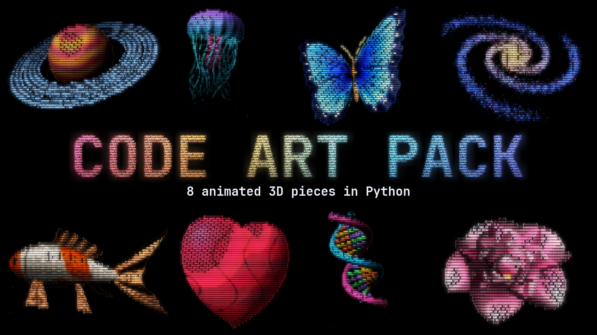

# ASCII art

Animated 3D ASCII art, made with Python, numpy and pygame. The pieces here are free to
download and run.

| Art | What happens | Code | Video |
| --- | --- | --- | --- |
| **Bloom** | A flower blooms, then blows away | [bloom3d.py](bloom/bloom3d.py) | [Watch](bloom/bloom3d.mp4) |
| **Butterfly** | A chrysalis cracks open and a butterfly flies out | [butterfly.py](butterfly/butterfly.py) | [Watch](butterfly/butterfly.mp4) |

## Want to make your own? Get the Code Art Pack

**[Get the Code Art Pack: $19, one-time](https://whop.com/thefrontier/code-art-pack-ascii-animations-in-python)**

| | Free, here | Code Art Pack |
| --- | :---: | :---: |
| Bloom and Butterfly | Yes | Yes |
| Jellyfish, Galaxy, Heart, Planet, DNA and Koi | | Yes |
| Interactive notebook with live demos | | Yes |
| Builder that writes a Python file from your choices | | Yes |
| Walkthroughs of all eight pieces | | Yes |
| Starter template and guides | | Yes |
| One-command video export, including 1080x1920 vertical | | Yes |
| Free updates as new pieces are added | | Yes |

You can post, monetize and sell the videos you make with the pack. You need Python 3.10 or newer.

## Run the free pieces

    git clone https://github.com/edwardjones7/ascii-art.git
    cd ascii-art
    pip install -r requirements.txt
    python bloom/bloom3d.py
    python butterfly/butterfly.py

Space restarts, Esc quits. Uses Consolas on Windows, Menlo on Mac and DejaVu Sans Mono or
Liberation Mono on Linux, so the look varies a little between systems.

## Export a video (needs ffmpeg)

Add `--record` to save the frames, then turn them into a video:

    python bloom/bloom3d.py --record
    ffmpeg -framerate 30 -i frames3d/f_%04d.png -c:v libx264 -pix_fmt yuv420p bloom3d.mp4

    python butterfly/butterfly.py --record
    ffmpeg -framerate 30 -i frames/f_%04d.png -c:v libx264 -pix_fmt yuv420p butterfly.mp4

## License

The free code in this repo is under the [MIT License](LICENSE). The Code Art Pack is sold
separately under its own terms, included with the download. The preview image of the pack isn't
covered by the MIT License.

By @edjonesv
